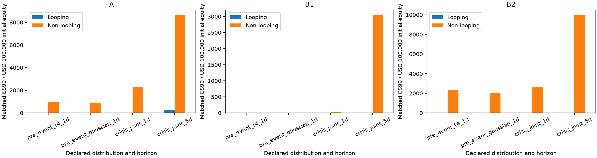
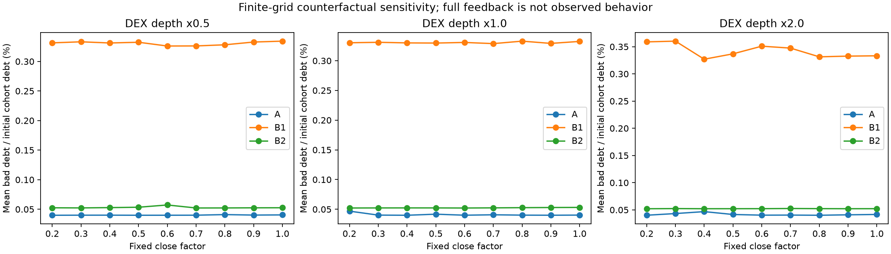
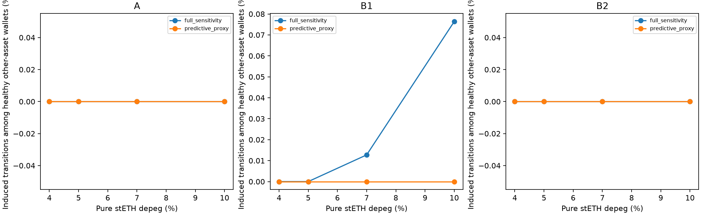

# Hoàn thiện kiểm định Q1–Q3 và sáu giả thuyết — 26/10/2026

Gói này hoàn thiện các phép kiểm định được yêu cầu, thay cho việc chỉ suy luận từ mô tả hoặc số lượng test đạt. Kết luận được phân theo từng giả thuyết. Kết quả không ủng hộ giả thuyết được giữ nguyên; không điều chỉnh dữ liệu để ép giả thuyết đúng.

## Những phần đã bổ sung

- Thu thập riêng 366 mức giá trước B1 và trước B2; A dùng 366 mức giá trước A. Mọi quote hiệu chỉnh Q1 đều trước snapshot tương ứng.
- Thu thập giai đoạn khủng hoảng tháng 5–7/2022: 90/92 ngày có đủ hai giá tươi trong giờ cuối ngày. Hai ngày thiếu được báo rõ trong coverage.json, không nội suy và không tính lợi suất bắc qua khoảng trống.
- Mỗi snapshot chạy 10.000 kịch bản ở bốn phân phối: t-copula và Gaussian-copula từ cửa sổ trước sự kiện, cùng bootstrap chung ETH/depeg khủng hoảng ở kỳ hạn 1 và 5 ngày. Tổng **120.000** kết quả kịch bản. Kỳ hạn 5 ngày là shock đầu-cuối, chưa phải mô phỏng đường giá từng ngày với tái cân bằng/lãi suất.
- Ghép equity 1:1 không lặp ví đối chứng, caliper log-equity 0,1; có bảng standardized mean difference trước/sau ghép. Không ghép HF/leverage vì đây có thể là biến trung gian của chiến lược. Các đặc điểm chưa quan sát vẫn có thể gây nhiễu. Hiệu chỉnh Holm trên toàn bộ 24 so sánh PBD/BDR theo snapshot/phân phối.
- Đo trực tiếp độ cong loss-gap trên 31 mức depeg, ở ETH shock 0% và -20%; bootstrap theo cặp ví giữ nguyên trục shock.
- Lưới CF gồm 9 mức cố định 20%–100%, 3 độ sâu, 6 shock, 3 snapshot và 3 chế độ feedback: **1458 ô**. Chế độ predictive-proxy bằng fixed khi dữ liệu không ủng hộ hệ số truyền dương.
- H3 tách loss trực tiếp và loss tăng thêm do feedback; chỉ đếm đúng nhóm HF ban đầu ≥1,10, còn khỏe sau shock ngoại sinh, có collateral khác STETH/WSTETH ít nhất 10% và 100 USD.
- Compound được kiểm tra thêm eligibility trước/sau tác động giá từ Aave và ghi riêng absorb/buyCollateral theo trạng thái đã quan sát. Lượng bán Comet bắt đầu từ dòng bán DEX cộng dồn của Aave, không reset pool. Đây là sensitivity giá thị trường chung một chiều trên mẫu ví overlap; chưa đưa bán collateral Comet quay lại Aave thành vòng lặp, không tự suy ra hành vi rút vốn hay chứng nhận oracle Comet phản ứng giống oracle Aave.
- Kiểm định và hồi quy centrality với **loss tăng thêm**, thêm null có điều kiện degree/exposure và can thiệp chặn nguồn thanh lý tại top 1% ví, 19 tập ví ngẫu nhiên ghép degree/exposure, cùng từng route. Giữ nguyên số dư tài chính; loại ví can thiệp khỏi thước đo người nhận để tránh tạo tác cơ học. Các network-label null là đối chứng ghép tên ví trong cấu trúc cố định, khác với rewiring giữ bậc đã có ở gói trước.

## Kết quả hiệu chỉnh và kiểm định thời gian

B1 dùng để ước lượng dự báo phản hồi DEX→oracle; B2 được giữ riêng để kiểm tra. Có 296 dòng train và 296 dòng test, với feature luôn trước target một block.

- Hệ số DEX cộng các độ trễ: `4.40701e-11`, CI HAC 95% `[-9.716684876729278e-11, 1.8530699428031384e-10]`.
- RMSE ngoài mẫu: `2.43071e-13`; baseline không thay đổi: `2.42687e-13`.
- Có cải thiện ngoài mẫu: **False**. Quy tắc chọn proxy cho kết quả **0.0**.
- Biến động tỷ giá oracle wstETH/WETH trong các cửa sổ này rất nhỏ: độ lệch chuẩn target `4.68681e-13`. Không diễn giải hệ số gần 0 như bằng chứng mọi oracle đều không phản ứng trong mọi khủng hoảng.

Đây là kiểm định dự báo bằng dữ liệu quan sát, chưa nhận dạng tác động nhân quả. Khối lượng collateral bị tịch thu chỉ là proxy dòng bán, không chứng minh liquidator đã bán ngay trên DEX. Các cửa sổ peak được chọn hồi cứu theo giao thức đã chốt từ trước, không chọn lại theo kết quả fit.

Đã đọc mới 1.800 quan sát slot0 tại ba tuyến, đối chiếu block hash và timestamp với raw RPC. Kiểm tra riêng từng cặp oracle/DEX cho kết quả:

| Tuyến | Proxy được chọn | Target vượt độ phân giải | Cải thiện ngoài mẫu |
|---|---:|---|---|
| wstETH->WETH | 0 | False | False |
| WETH->USDC | 0 | True | False |
| WBTC->WETH | 0 | True | False |

Proxy bằng 0 là quy tắc bảo thủ khi kiểm định dự báo không đạt, không phải ước lượng nhân quả rằng tác động thật luôn bằng 0. Riêng tỷ giá oracle wstETH/WETH gần như không thay đổi trong hai peak nên không có đủ biến thiên ở độ phân giải này để nhận dạng độ truyền dương.

## Bảng kết luận cho sáu giả thuyết

| Giả thuyết | Kết luận từ kiểm định hiện tại |
|---|---|
| H1a | Không được ủng hộ trong thiết kế hiệu chỉnh trước sự kiện. Có 0/3 snapshot thỏa đồng thời CI dương và p Holm <0,05 cho PBD và BDR trong thiết kế chính. Xem thêm các phân phối khủng hoảng trước khi suy rộng. |
| H1b | Có độ cong quadratic dương ở một số điều kiện, chưa đồng nghĩa lồi trên toàn miền. ES99 lớn hơn trung vị không tự chứng minh khuếch đại do looping. Không chia cho trung vị bằng 0. |
| H2a | Trong 54 cặp full-feedback, có 17 cặp đồng thời tăng lượng bán vòng đầu và số ví mới đủ điều kiện khi CF100 thay CF50. Đây là mức ủng hộ có điều kiện, không phải quy luật tổng quát. |
| H2b | Có 0/9 mặt cắt trung bình thỏa kiểm tra hai độ dốc biên và CI điểm cực tiểu nằm hoàn toàn trong miền CF. Không coi quadratic dương đơn thuần là chữ U. |
| H3a | Proxy được kiểm định tạo tổng 0 lượt ví khỏe/tài sản khác bị kích hoạt trong 12 tổ hợp; full-feedback sensitivity tạo 7. Đây là lượt theo kịch bản, không phải số ví duy nhất; mô phỏng sensitivity không xác nhận lây lan thực tế. |
| H3b | Đã đo tổn thất lây lan tăng thêm, kiểm định null và can thiệp nguồn/cạnh. Đây là bằng chứng trong mô hình có điều kiện, chưa xác nhận power-law hoặc cơ chế nhân quả ngoài thực tế. |

Số lượng kịch bản chạy, test phần mềm đạt hoặc mapping đủ KPI không thay thế các kết luận riêng trong bảng trên.

## Câu trả lời cho Q1–Q3

**Q1:** Định lượng được chênh lệch giữa các nhóm vị thế đại diện cho looping/non-looping trong từng snapshot, cùng equity gần nhau và cùng kịch bản. Dưới thiết kế chính hiệu chỉnh trước sự kiện, ES99 sau thanh lý trên 100.000 USD equity là:

| Snapshot | Cặp equity | ES99 looping | ES99 non-looping |
|---|---:|---:|---:|
| A | 262 | 0.0000 | 953.9851 |
| B1 | 288 | 0.0000 | 0.0000 |
| B2 | 316 | 0.0000 | 2334.9889 |

So sánh thêm 1 và 5 ngày khủng hoảng được lưu riêng; không coi 5 ngày là cùng kỳ hạn với 1 ngày. Các nhóm không được gán ngẫu nhiên chiến lược nên chênh lệch chưa phải tác động nhân quả của việc thực hiện vòng lặp.

**Q2:** Đã có phản thực định lượng trên 9 CF với cùng shock, độ sâu, cohort và giả định feedback; đo được thu hồi nợ, bán vòng đầu, bad debt và ví mới bị kích hoạt. Kết quả phụ thuộc điều kiện, không suy ra một CF tối ưu chung hoặc mặc định tồn tại chữ U.

**Q3:** Đã tách chuyển trạng thái trực tiếp và phần tăng thêm trong mô hình, đo đúng tập ví khỏe/tài sản khác, đồng thời kiểm định dự báo phản hồi bằng B2 giữ riêng. Việc không quan sát được phản hồi dương có khả năng dự báo là kết quả dữ liệu trong cửa sổ kiểm tra; chưa nhận dạng tác động nhân quả cho toàn thị trường. Kết quả full-feedback chỉ là sensitivity, không dùng thay bằng chứng thực nghiệm.

Trong 48 tổ hợp Compound, predictive-proxy tạo 0 lượt account mới đủ điều kiện; full-feedback sensitivity tạo 9. Account được phân theo thị trường; không coi các lượt theo kịch bản là ví duy nhất. Không đồng nhất việc absorb xóa nợ người vay với tổn thất ròng của giao thức.

## Miền hiệu lực

Chỉ ba route đã chốt và miền quote được quan sát được dùng để thực thi; vượt miền hoặc thiếu route là unknown, không chứng minh freeze. Phí gas 5 USD và việc giữ nguyên danh mục khi áp shock là giả định nghiên cứu. Bootstrap theo ví/scenario và thay đổi phân phối không loại bỏ mọi bất định về hiệu chỉnh từ mẫu lịch sử hữu hạn. Các CI về độ cong và chữ U mô tả độ bền trên lưới/các block kịch bản đã chọn, không phải bằng chứng nhân quả trên tổng thể thị trường.

## Hình từ artifact







## Nguồn và tái lập

- `preregistered_settings.json`: thiết kế đóng trước khi chạy; `input_freeze.json`: hash dữ liệu quan sát trước khi tính.
- `q1/paired_hypothesis_tests.json`, `q1/convexity_tests.json`: kết quả đầy đủ từng snapshot/phân phối.
- `q2/dense_cf_grid.csv`, `q2/u_shape_tests.json`, `q2/h2a_paired_contrasts.csv`.
- `q2/u_shape_tests_with_turning_ci.json`: CI điểm đảo chiều và tiêu chí chữ U chặt hơn.
- `feedback/validation.json`, `q3/direct_induced_summary.csv`, `q3/incremental_loss_network_nulls.json`, `q3/node_edge_interventions.csv`.
- `feedback/route_validation.json`, `feedback/route_data_qa.json`, `feedback_input_freeze.json`: kiểm tra cả ba route và nguồn archive độc lập.
- `q1/equity_balance_before_after.csv`, `q1/paired_hypothesis_tests_adjusted.json`, `q3/incremental_loss_regressions.json`.
- `q3/compound_direct_induced_summary.csv`, `q3/compound_conditional_execution_ledger.parquet`, `compound_input_freeze.json`: kênh giá liên giao thức với phạm vi và giả định riêng.
- `*_completed.json` và `source_versions/`: mã đúng phiên bản đã thực hiện từng giai đoạn, kể cả khi sửa bước báo cáo sau đó.
- `software_versions.json`: phiên bản phần mềm; thiết kế đóng trong kho trước lượt chạy là giao thức nội bộ, chưa phải đăng ký nghiên cứu tại bên thứ ba.

```powershell
.\.venv\Scripts\python.exe -B -X utf8 -m scripts.n5_collect_pre_event_market
.\.venv\Scripts\python.exe -B -X utf8 -m scripts.n5_collect_dex_feedback
.\.venv\Scripts\python.exe -B -X utf8 -m scripts.n5_complete_hypotheses --output-dir outputs/N5_HYPOTHESES_NEW
```

Giá lịch sử lấy qua [API chính thức DefiLlama](https://api-docs.defillama.com/). Quote thị trường có thể không hoàn toàn đồng thời; không dùng thay oracle Aave. Chênh lệch giữa snapshot và phân phối được báo cáo, không tuyên bố miễn nhiễm hay khuếch đại tổng quát khi bằng chứng không đủ.
