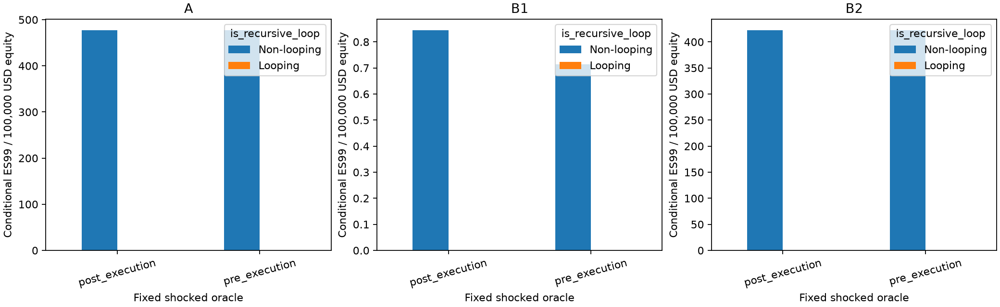
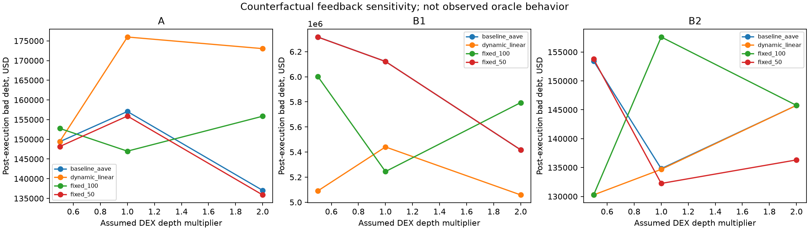
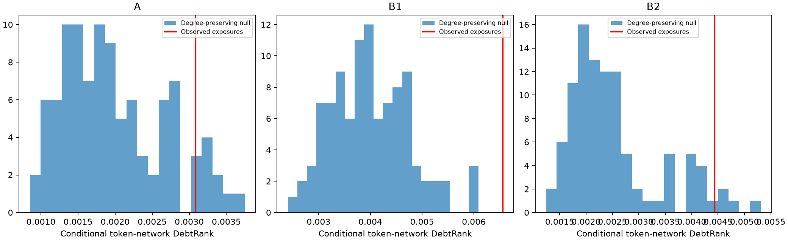

# Kết quả xử lý rà soát nghiên cứu ngày 26/10/2026

Bộ này thay thế các kết luận Q1–Q3 trong báo cáo hoàn thành cũ. Dữ liệu gốc và bundle cũ được giữ để truy nguyên.

## P0 — Dữ liệu và nghiệm thu

- Chuẩn hóa market Compound WETH từ đơn vị WETH sang USD bằng oracle WETH/USD cùng snapshot; giữ native_price/native_value và tỷ giá chuyển đổi.
- Mọi khoản rút vốn có cả lượng token và USD; chọn ví theo snapshot và điều kiện đủ ngưỡng thanh lý Aave trong kịch bản đã ghi rõ.
- Kết quả kiểm tra file/cột được gọi là mapping; kiểm tra số học được ghi riêng ở validation.json. Không dùng mapping 18/18 để tuyên bố nghiệm thu khoa học.
- Trạng thái nghiệm thu: **pending_external_validation_of_feedback_and_protocol_execution**.

## Q1

- 10,000 vector shock được đánh giá trước và sau thanh lý bằng cùng một bộ giá, cùng cohort, cùng route, cùng phí và cùng quy tắc Close Factor.
- Mô phỏng giữ số dư và LT/bonus từng token, giới hạn miền quote, lượng bán cộng dồn theo pool và thực thi tới khi dừng. Không dùng đường trượt giá trung bình giữa các route.
- ES99 dùng toàn bộ số lần rút mẫu, gồm loss bằng 0. Loại equity không dương khỏi phép chia, vẫn giữ các ví này trong artifact và báo cáo.
- So sánh dùng trọng số bằng nhau giữa các tầng equity chung. Đây là điều chỉnh phân tầng, chưa phải ước lượng nhân quả của looping.
- Mann–Whitney BDR và KS HF được ghi theo tầng; bootstrap ES99 ghép cặp theo cùng scenario, có CI và hiệu chỉnh Holm. Kiểm định wallet dùng chung cú sốc chỉ có ý nghĩa mô tả liên hệ.
- 19 kịch bản stress là kiểm tra tất định; không gán tần suất stress bằng xác suất đời thực hay dùng ES99 trên 19 điểm như ước lượng đuôi thực nghiệm.
- Áp calibration trước A vào B1/B2 là phản thực hồi cứu, chưa phải kiểm định ngoài mẫu không nhìn trước.



## Q2

- Đã chạy **1368** tổ hợp snapshot × shock × độ sâu × CF × phản hồi giá.
- Độ sâu 0,5/1/2 là giả định phản thực trên cùng đường quote, không phải ba thị trường được quan sát độc lập.
- Bản fixed oracle, depth=1, baseline_aave khớp 57 lượt primary cũ: **True**.
- Đếm riêng giao dịch lặp lại, ví được thực thi lần đầu ở vòng sau và ví mới đủ điều kiện ở vòng sau. Ngoài miền quote là unknown; không coi đó là freeze đã được chứng minh.
- Bảng paired_policy_contrasts so sánh chính sách trong cùng snapshot/scenario/depth; không gán p-value ANOVA iid cho các ô mô phỏng phụ thuộc.



## Q3

- Fixed oracle không sinh ví mới đủ điều kiện qua phản hồi giá; kiểm tra zero-control: **True**.
- Bản phản thực truyền marginal cost suy từ đường DEX vào giá token bán, cập nhật cả collateral và debt. Giá được tính từ mức sau shock ban đầu, không nhân lặp lại impact toàn phần mỗi vòng. Mức truyền 100%, cap 15% là sensitivity chưa hiệu chỉnh từ oracle thực.
- Số ví mới đủ điều kiện lớn nhất trong một lượt phản thực: **337**. Chỉ số này là kết quả mô hình có điều kiện, chưa chứng minh H3 trên dữ liệu thực.
- Mạng giữ ví riêng lẻ, token và các lớp phơi nhiễm Aave/Compound. Null dùng double-edge swap trong từng lớp, bảo toàn bậc của từng ví và từng token; giữ tập trọng số cạnh của ví nhưng không giữ tổng trọng số mỗi token.
- Xuất eigenvector, degree, strength theo từng ví và phân phối null. DebtRank đo truyền distress trên phơi nhiễm, chưa đồng nhất với bad debt được thực thi. Chưa kết luận power-law hoặc trung tâm mạng gây lây lan.
- Compound: đã sửa USD; thu thập reserves, target reserves, pause, storefront và collateral inventory tại đủ 6 market–snapshot qua RPC chỉ đọc. Mô hình tách absorb (xóa nợ, nhận collateral, ghi credit base supply của người vay) và buyCollateral (mua từ inventory khi reserves dưới target, dùng discount riêng Comet). Chỉ bán khi route có quote trong miền và liquidator có lãi theo giả định. Base supply không phải collateral. Mẫu chỉ gồm ví overlap; không khẳng định mô phỏng toàn bộ thị trường hoặc làm tròn/lãi suất của hợp đồng. Ledger và summary riêng được bàn giao.



## P2 — Bảng và hình

Các hình trên được tạo trực tiếp từ CSV của bộ này. manifest.json băm các đầu vào, mã nguồn, CSV, Parquet, hình và báo cáo; validation.json ghi riêng kiểm tra hồi quy/số học và mức nghiệm thu.

## Chạy lại

```powershell
.\.venv\Scripts\python.exe -B -X utf8 -m scripts.n5_resolve_research_review --output-dir outputs/N5_REVIEW_NEW
```

Tài liệu cơ chế Compound: https://docs.compound.finance/liquidation/


## Kiểm định cấu trúc bổ sung

`q3_wallet_structural_tests.json` và `A|B1|B2/top200_wallet_bridges.csv` bổ sung betweenness có trọng số giữa các cặp token (tính mọi đường đi ngắn nhất, gồm trường hợp hòa), hồi quy liên hệ BDR với centrality có kiểm soát quy mô vốn và HF, cùng kiểm tra đuôi Pareto bằng bootstrap KS. Những phép này là chẩn đoán cấu trúc/liên hệ; không biến tương quan thành bằng chứng nhân quả hoặc chứng minh power-law. HC3 không loại bỏ phụ thuộc mạng.

Để tái lập bước bổ sung sau runner chính:

```powershell
.\.venv\Scripts\python.exe -B -X utf8 -m scripts.n5_finalize_structural_review --bundle outputs/N5_REVIEW_NEW
```
